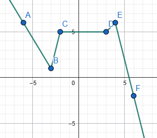

# Zigzag

Generator of zigzag function comming through all provided points. The result can be directly pasted to GeoGebra.



## Usage

```
python zigzag.py -6 6 -3 1 -2 5 3 5 4 6 6 -2
```

## Running tests

```
pip install pytest
pytest
```
